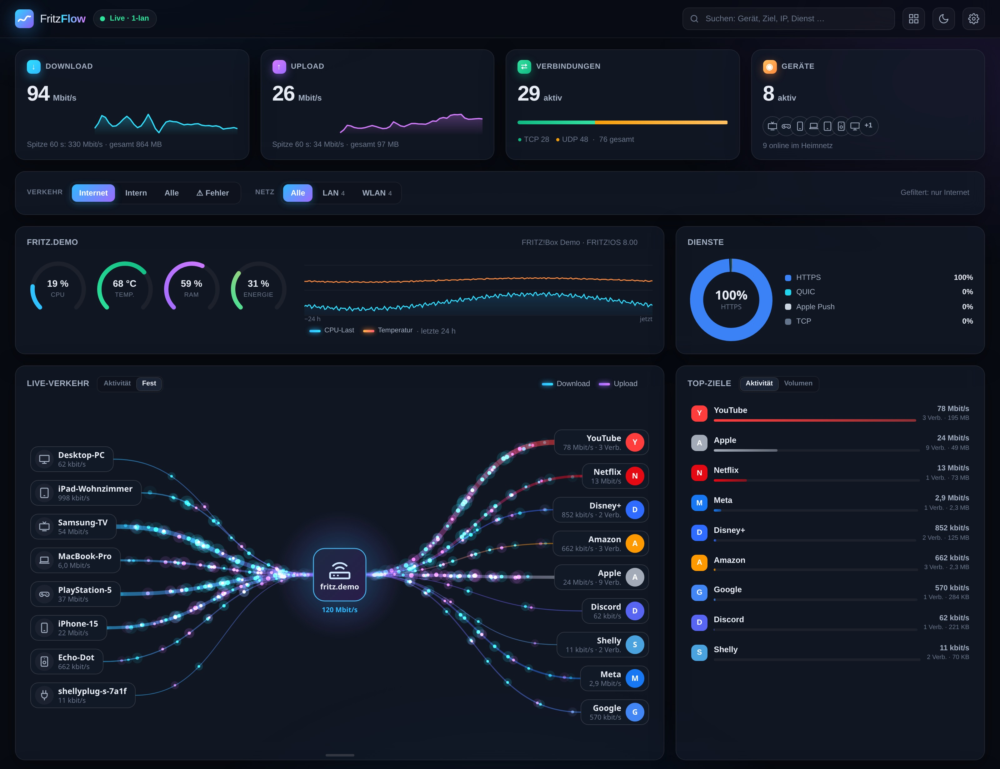
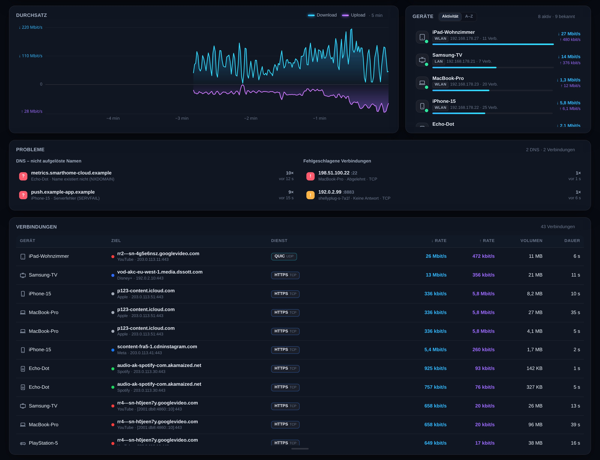

# fritzFlow

**Live sehen, welches Gerät in deinem Heimnetz mit wem spricht – direkt aus der FRITZ!Box.**

FritzFlow nutzt den eingebauten Paketmitschnitt der FRITZ!Box und macht daraus ein
Live-Dashboard: Geräte, Ziele (Domains/Dienste), Durchsatz und jede einzelne Verbindung.
Eine einzige Programmdatei für Windows, macOS und Linux – ohne Installation, ohne
Abhängigkeiten, ohne Cloud.



<details>
<summary><b>Weitere Ansicht:</b> Durchsatz, Geräte, Probleme und Verbindungstabelle</summary>



</details>

*Screenshots im Demo-Modus – alle Geräte, Ziele, Störungen und Werte sind simuliert.*

> **English:** FritzFlow turns the built-in packet capture of an AVM FRITZ!Box router into a live
> dashboard showing which device talks to which service. Single binary for Windows, macOS and Linux,
> no dependencies, no cloud – everything stays on your computer. The UI is in German.
> Note: while any packet capture runs, the FRITZ!Box forwards traffic much slower (7590: ~55 instead
> of 262 Mbit/s); FritzFlow therefore pauses the capture automatically while the line is busy.

## Funktionen

- **Live-Verkehrskarte**: Geräte → FRITZ!Box → Ziele, animiert nach Durchsatz
- **Verbindungstabelle**: Gerät, Ziel-Hostname, Dienst, Rate, Volumen, Dauer – sortier- und filterbar
- **Hostnamen** aus DNS-Antworten, TLS-SNI und HTTP-Host; optional Reverse-DNS
- **Gerätenamen** aus der FRITZ!Box (TR-064 oder – falls deaktiviert – Heimnetz-Übersicht)
- **Download/Upload**, Verbindungen, aktive Geräte, 5-Minuten-Verlauf, Dienste-Verteilung
- **Filter** für die ganze Ansicht: Verkehr *Internet / Intern / Alle*, Netz *LAN / WLAN 2,4 GHz / WLAN 5 GHz / Gast*, einzelnes Gerät, Suche
- **Probleme erkennen**: nicht aufgelöste DNS-Namen (NXDOMAIN, SERVFAIL, keine Antwort) und
  fehlgeschlagene Verbindungen (keine Antwort, abgelehnt, nicht erreichbar) – mit Filter „Fehler“
- **Kacheln ein-/ausblenden** über das Ansicht-Menü (ausgeblendete Kacheln kosten keine Rechenzeit)
- **Sortierung pro Ansicht**: nach Aktivität oder ruhig/statisch (Fest, Volumen, A–Z)
- **Auto-Pause**: Ist die Internetleitung ausgelastet, pausiert der Mitschnitt von selbst, damit
  die FRITZ!Box wieder mit voller Geschwindigkeit weiterleitet (siehe [Geschwindigkeit](#geschwindigkeit-und-last-der-fritzbox)).
  Pause-Knopf oben neben dem Status
- **Name, Modell und FRITZ!OS-Version** der Box werden angezeigt
- **FRITZ!Box-Daten** (abschaltbar, FRITZ!OS 8): CPU-Last, Temperatur, RAM, Energieverbrauch mit
  24-h-Verlauf sowie der **Online-Monitor** – echter Durchsatz am Anschluss, Leitungsauslastung und
  wie viel davon der Mitschnitt sieht (hardwarebeschleunigter Verkehr fehlt im Mitschnitt).
  Zugangsdaten des Internetanbieters und die öffentliche IP werden dabei nicht ausgelesen.
- Dark Mode (Standard) und Light Mode
- **Demo-Modus** mit simulierter FRITZ!Box: `fritzflow -demo`

## Voraussetzungen

- Eine **FRITZ!Box als Router** (der Paketmitschnitt steht nur im Router-Betrieb zur Verfügung)
- Ein FRITZ!Box-Benutzer mit dem Recht **„FRITZ!Box Einstellungen“** (siehe unten)
- Ein Rechner im selben Heimnetz mit einem aktuellen Browser
- Für CPU, Temperatur, Energie und Online-Monitor: **FRITZ!OS 8** oder neuer (ohne diese
  Anzeigen läuft FritzFlow auch mit älteren Versionen)

Getestet mit einer FRITZ!Box 7590 unter FRITZ!OS 8.5x. Andere Modelle sollten funktionieren,
solange sie den Paketmitschnitt anbieten – Rückmeldungen sind willkommen.

## Schnellstart

1. Die passende Datei herunterladen – ein Klick lädt immer die **neueste Version**:

   | Dein System | Download |
   |---|---|
   | **Windows** – fast alle PCs und Laptops (Intel/AMD) | **[fritzflow-windows-amd64.exe](https://github.com/sabieler/fritzFlow/releases/latest/download/fritzflow-windows-amd64.exe)** |
   | Windows auf ARM (z. B. Snapdragon, Surface Pro X) | [fritzflow-windows-arm64.exe](https://github.com/sabieler/fritzFlow/releases/latest/download/fritzflow-windows-arm64.exe) |
   | **macOS** mit Apple-Chip (M1, M2, M3, M4 …) | **[fritzflow-darwin-arm64](https://github.com/sabieler/fritzFlow/releases/latest/download/fritzflow-darwin-arm64)** |
   | macOS mit Intel-Prozessor (ältere Macs) | [fritzflow-darwin-amd64](https://github.com/sabieler/fritzFlow/releases/latest/download/fritzflow-darwin-amd64) |
   | **Linux** – normaler PC | **[fritzflow-linux-amd64](https://github.com/sabieler/fritzFlow/releases/latest/download/fritzflow-linux-amd64)** |
   | Raspberry Pi 3/4/5 mit 64-Bit-System | [fritzflow-linux-arm64](https://github.com/sabieler/fritzFlow/releases/latest/download/fritzflow-linux-arm64) |
   | Raspberry Pi mit 32-Bit-System | [fritzflow-linux-arm](https://github.com/sabieler/fritzFlow/releases/latest/download/fritzflow-linux-arm) |

   Alle Dateien, Prüfsummen (`SHA256SUMS`) und ältere Versionen: [Releases](https://github.com/sabieler/fritzFlow/releases).
   Die Version zeigt das Programm in der Fußzeile der Oberfläche oder mit `-version`.

   Welcher Mac? Apple-Menü → *Über diesen Mac* → steht dort „Chip: Apple M…“, ist es `darwin-arm64`.

   Starten:
   - **Windows:** Datei doppelklicken. Bei „Der Computer wurde durch Windows geschützt“
     auf *Weitere Informationen → Trotzdem ausführen* klicken (die Datei ist nicht signiert).
   - **macOS:** im Terminal im Download-Ordner:
     `chmod +x fritzflow-darwin-arm64 && xattr -d com.apple.quarantine fritzflow-darwin-arm64 && ./fritzflow-darwin-arm64`
   - **Linux:** `chmod +x fritzflow-linux-amd64 && ./fritzflow-linux-amd64`

   Oder selbst bauen (Go ≥ 1.21): `go build -o fritzflow .` bzw. `./scripts/build.sh` für alle Plattformen.
2. Der Browser öffnet sich automatisch unter <http://localhost:8484>.
3. Im Einrichtungsdialog FRITZ!Box-Adresse, Benutzer und Passwort eingeben →
   **Verbindung testen** → **Speichern & starten**.

### Echtheit der Datei prüfen (optional)

Jede Programmdatei wird von GitHub Actions aus dem öffentlichen Quellcode gebaut und mit einem
signierten **Build-Nachweis** versehen. Mit der [GitHub-CLI](https://cli.github.com/) lässt sich
prüfen, dass die Datei unverändert aus diesem Repo stammt:

```sh
gh attestation verify fritzflow-windows-amd64.exe -R sabieler/fritzFlow
```

Ohne GitHub-CLI genügt der Abgleich mit den Prüfsummen aus `SHA256SUMS`
(`sha256sum fritzflow-linux-amd64`, unter Windows `certutil -hashfile fritzflow-windows-amd64.exe SHA256`).

Hinweis: Die Dateien sind nicht mit einem kostenpflichtigen Windows- bzw. Apple-Zertifikat signiert.
Deshalb warnen Windows SmartScreen und macOS Gatekeeper beim ersten Start (siehe oben) – der
Build-Nachweis ändert daran nichts, belegt aber die Herkunft.

### Empfohlener FRITZ!Box-Benutzer

Lege unter *System → FRITZ!Box-Benutzer* einen eigenen Benutzer an (z. B. `fritzFlow`):

- Recht **„FRITZ!Box Einstellungen“** (zwingend für den Paketmitschnitt)
- **kein** „Zugang aus dem Internet“

So bleibt dein Admin-Zugang unberührt, und der Zugang lässt sich jederzeit sperren.

## Geschwindigkeit und Last der FRITZ!Box

**Wichtig:** Solange irgendein Paketmitschnitt läuft – egal ob über FritzFlow, ein anderes Werkzeug
oder die Box-Oberfläche –, leitet die FRITZ!Box Daten deutlich langsamer weiter. In einem Test mit
einer FRITZ!Box 7590 an einer 250-Mbit/s-Leitung sank der Download von 262 auf etwa 55 Mbit/s,
unabhängig von Schnittstelle und Detailgrad. Nach dem Ende des Mitschnitts ist sofort wieder die
volle Geschwindigkeit da. Wie stark der Effekt bei anderen Modellen ist, ist nicht getestet.

Darum gibt es die **Auto-Pause** (Standard, FRITZ!OS 8): FritzFlow liest den Durchsatz am
Anschluss über den Online-Monitor der Box, der dafür keinen Mitschnitt braucht. Liegt er 10 s lang
über 30 Mbit/s (Download oder Upload), stoppt FritzFlow den Mitschnitt; im Test lief der Download
nach 15–20 s wieder mit voller Geschwindigkeit. Liegt der Durchsatz 60 s lang im Schnitt unter
15 Mbit/s, startet der Mitschnitt neu (nach wiederholten Pausen kurz hintereinander länger).
Während der Pause zeigt FritzFlow den Hinweis „Pausiert · Leitung ausgelastet“; Verkehr in dieser
Zeit erscheint nicht pro Gerät. Mit **„Jetzt fortsetzen“** läuft der Mitschnitt trotz Last weiter
(Auto-Pause dann 10 Minuten aus). Bei anhaltend hoher Last, etwa langem 4K-Streaming, bleibt
der Mitschnitt entsprechend lange pausiert.

Außerdem:

- Pro Paket überträgt die Box nur die ersten Bytes (**Detailgrad**, Standard 200 B) – keine Inhalte.
- Standardmäßig läuft der Mitschnitt **nur, solange die Ansicht geöffnet ist** (20 s Nachlauf).
- Die Geräteliste wird nur alle 5 Minuten abgefragt.
- Die aktuelle Zusatzlast siehst du unten in der Fußzeile („Mitschnitt-Last“).
- Bei Fehlern wird mit wachsendem Abstand neu verbunden; nach falschem Passwort frühestens nach 60 s,
  damit die Box keine Anmeldesperre verhängt.

| Detailgrad | Bytes/Paket | Wofür |
|---|---|---|
| Sparsam | 128 | geringste Last, weniger Hostnamen |
| Ausgewogen | 200 | Standard |
| Detailliert | 512 | erkennt mehr Hostnamen (TLS-SNI) |

## Konfiguration

Die Einstellungen werden im Browser vorgenommen und gespeichert unter

- Linux: `~/.config/fritzflow/config.json`
- macOS: `~/Library/Application Support/fritzflow/config.json`
- Windows: `%AppData%\fritzflow\config.json`

Die Datei ist nur für den eigenen Benutzer lesbar (0600). Alternativ per Umgebungsvariablen
(werden nicht in die Datei geschrieben): `FRITZFLOW_HOST`, `FRITZFLOW_USER`, `FRITZFLOW_PASSWORD`.

| Schlüssel | Standard | Bedeutung |
|---|---|---|
| `fritzbox` | `http://fritz.box` | Adresse der Box |
| `username` / `password` | – | FRITZ!Box-Benutzer |
| `interface` | `1-lan` | Mitschnitt-Schnittstelle (`1-lan` = LAN+WLAN, `2-1` = Internet, `3-0` = Routing-Schnittstelle). Die Kennungen stammen von der FRITZ!Box (Start-Knöpfe unter `https://fritz.box/html/capture.html`) |
| `capture_guest` | `false` | Gastnetz zusätzlich mitschneiden (`1-guest`). Das Gastnetz ist auf der Box eine eigene Schnittstelle und nicht in `1-lan` enthalten; erst damit zeigt der Netz-Filter „Gast“ Verkehr. Etwas mehr Last auf der Box |
| `snaplen` | `200` | Bytes pro Paket (64–1600) |
| `capture_mode` | `on-demand` | oder `always` |
| `reverse_dns` | `true` | unbekannte IPs per PTR benennen |
| `auto_pause` | `true` | Mitschnitt pausieren, solange die Internetleitung ausgelastet ist (braucht FRITZ!OS 8) |
| `box_stats` | `true` | FRITZ!Box-Daten abfragen (Online-Monitor alle 5 s, Auslastung alle 30 s) |
| `listen` | `127.0.0.1:8484` | Adresse der Weboberfläche |
| `open_browser` | `true` | Browser beim Start öffnen |
| `exit_after_minutes` | `2` | FritzFlow beendet sich so viele Minuten nach dem Schließen des letzten Tabs; `0` = weiterlaufen. Gilt nicht bei `capture_mode: always`; auch im Einstellungsdialog einstellbar |
| `browser` | *(Systemstandard)* | Browser für die Oberfläche: ein im Einstellungsdialog angebotener Browser oder der vollständige Pfad zur Programmdatei (z. B. `/usr/bin/vivaldi`, `C:\…\chrome.exe`, `/Applications/Arc.app`) |

Kommandozeile: `-config <pfad>`, `-listen <addr>`, `-no-browser`, `-exit-after <minuten>` (überschreibt `exit_after_minutes`, `0` = nie beenden), `-demo`, `-version`.

## Fehlerbehebung

- **Keine Live-Daten im Browser:** Werbe-/Tracker-Blocker (z. B. in Vivaldi, Brave, uBlock Origin)
  können lokale Datenströme stören. FritzFlow weicht automatisch auf einfache Abfragen aus und
  zeigt sonst einen Hinweis – dann den Blocker für `localhost` deaktivieren.
- **„Auf 1-lan läuft bereits ein anderer Mitschnitt“:** Die FRITZ!Box erlaubt pro Schnittstelle nur
  einen Mitschnitt. Läuft FritzFlow auf zwei Rechnern oder ist der Mitschnitt in der FRITZ!Box-Oberfläche
  aktiv, wartet FritzFlow. Hängende Mitschnitte einer abgestürzten Instanz beendet FritzFlow selbst.
- **„Auf 1-lan hängt noch ein alter Mitschnitt“ / „Eingeschränkte Ansicht“ nach LAN/WLAN-Wechsel:**
  Wird der Netzwerkadapter abgeschaltet, während FritzFlow mitschneidet, merkt die FRITZ!Box das nicht.
  Sie sendet den Mitschnitt vermutlich weiter an die verschwundene Adresse, bis ihr TCP aufgibt. In einem
  Test mit einer FRITZ!Box 7590 (FRITZ!OS 8.54 Beta) dauerte das **etwa 16 Minuten**; das passt zum
  Linux-Standard (`tcp_retries2` = 15, rund 15½ Minuten), ist aber nicht von AVM dokumentiert und kann
  länger dauern. So lange bleibt die Schnittstelle belegt – weder „Stopp“ noch „Alle stoppen“ (auch nicht in der
  FRITZ!Box-Oberfläche) noch Abmelden beendet ihn vorher; nur ein Neustart der Box hilft sofort.
  FritzFlow erkennt den Netzwechsel, versucht beide Stopp-Varianten und weicht dann auf die
  Routing-Schnittstelle `3-0` aus: Sie zeigt allen Verkehr über den Router mit lokalen Adressen, aber
  keinen Verkehr zwischen Geräten im Heimnetz und keine MAC-Adressen. Alle 30 s prüft FritzFlow, ob
  `1-lan` wieder frei ist, und wechselt dann automatisch zurück. Wer innerhalb dieser Zeit mehrfach
  wechselt, kann auch `3-0` blockieren – dann hilft nur Warten (oder ein Box-Neustart).
  Unter Windows verwirft die Firewall die Pakete der Box an die alte Adresse stillschweigend; unter
  Linux/macOS beendet ein Reset des Rechners den alten Mitschnitt evtl. früher, sobald die alte Adresse
  wieder da ist (nicht getestet).
- **FritzFlow läuft nach dem Schließen des Browsers nicht mehr:** Gewollt – es beendet sich nach
  `exit_after_minutes` (Standard 2) ohne geöffnete Ansicht. `0` im Einstellungsdialog oder
  `-exit-after 0` hält es am Laufen.
- **Gerätenamen fehlen:** FritzFlow liest sie aus der Heimnetz-Übersicht bzw. per TR-064
  (*Heimnetz → Netzwerk → Netzwerkeinstellungen → Zugriff für Anwendungen zulassen*).

## Datenschutz

- **Alles bleibt lokal.** FritzFlow spricht nur mit deiner FRITZ!Box und – für die optionale
  Reverse-DNS-Auflösung – mit deinem normalen DNS-Server. Es gibt keine Cloud, kein Konto,
  keine Telemetrie und keine Update-Abfrage.
- **Keine Inhalte:** Ausgewertet werden nur Paket-Kopfdaten (Adressen, Ports, Größen) sowie
  Hostnamen aus DNS-Antworten, TLS-SNI und HTTP-Host. Paketinhalte werden weder gelesen noch
  gespeichert.
- **Nichts wird gespeichert:** Verbindungen und Geräte existieren nur im Arbeitsspeicher und sind
  nach dem Beenden weg. Auf der Festplatte liegt nur die Konfigurationsdatei.
- **Nicht ausgelesen** werden die Zugangsdaten deines Internetanbieters, deine öffentliche IP-Adresse
  und die Seriennummer der Box, auch wenn die FRITZ!Box sie über dieselben Schnittstellen liefert.

## Sicherheit

- Die Oberfläche lauscht standardmäßig nur auf `127.0.0.1`. Andere Hostnamen werden abgewiesen
  (Schutz vor DNS-Rebinding), schreibende Anfragen von fremden Webseiten ebenfalls.
- Wer `listen` auf `0.0.0.0` stellt, macht den Datenverkehr für alle im LAN sichtbar. **Einstellungen,
  Verbindungstests und der Browser-Start sind aber nur am Rechner selbst möglich** (Anfragen von
  `localhost`); aus dem LAN lässt sich nur zusehen.
- Als Browser startet FritzFlow ausschließlich einen erkannten Browser oder eine Programmdatei mit
  vollständigem Pfad – nie einen frei eingegebenen Befehl.
- Das FRITZ!Box-Passwort steht im Klartext in der Konfigurationsdatei (nur für deinen Benutzer
  lesbar). Wer das vermeiden will, nutzt `FRITZFLOW_PASSWORD` und einen eigenen, eingeschränkten
  FRITZ!Box-Benutzer.

## Rechtlicher Hinweis

Nutze FritzFlow nur in deinem eigenen Netz. Der Mitschnitt zeigt, welches Gerät wann mit welchen
Diensten kommuniziert – das sind personenbezogene Daten. **Informiere alle, die dein Netz
mitbenutzen** (Familie, Mitbewohner, Gäste), und hole bei Bedarf ihr Einverständnis ein. Die
Verantwortung für den Einsatz liegt bei dir.

## Wie es funktioniert

```
FRITZ!Box ──/cgi-bin/capture_notimeout──▶ pcap-Stream (nur Header)
          ──login_sid.lua (PBKDF2)──────▶ Session-ID
          ──TR-064 / data.lua───────────▶ Gerätenamen
                         │
                 FritzFlow (Go, Standardbibliothek)
   pcap/pcapng-Parser → Decoder (Ethernet/VLAN/IPv4/IPv6/TCP/UDP)
   → DNS/SNI/HTTP-Namen → Verbindungstabelle → Snapshot (1/s)
                         │  Server-Sent Events
                 Browser-UI (Vanilla JS, Canvas)
```

Router-MAC-Erkennung ordnet jede Verbindung dem lokalen Gerät zu – auch bei IPv6
mit Privacy-Adressen.

## Entwicklung

```sh
go test ./...                 # Unit- und Ende-zu-Ende-Tests (gegen simulierte Box)
go test -fuzz=FuzzDecode ./internal/flow
go run . -demo                # UI mit simulierten Daten
./scripts/build.sh            # alle Plattformen nach dist/ (lokal, nicht im Repo)
git tag vX.Y.Z && git push origin vX.Y.Z   # baut, testet und veröffentlicht automatisch ein Release
```

Struktur:

| Paket | Aufgabe |
|---|---|
| `internal/fritz` | Login, Mitschnitt-Stream, TR-064, Geräteliste |
| `internal/pcap` | pcap / pcapng / „modified pcap“ (FRITZ!OS) |
| `internal/flow` | Paket-Decoder, DNS/SNI, Verbindungs- und Geräte-Tracking |
| `internal/engine` | Ablaufsteuerung, Reconnect, On-Demand-Mitschnitt |
| `internal/web` | HTTP/SSE-Server, eingebettete Oberfläche |
| `internal/fakebox` | simulierte FRITZ!Box für Demo und Tests |

Keine externen Go-Module, keine CDN-Abhängigkeiten.

## Danksagung

Die Idee, den versteckten Live-Mitschnitt der FRITZ!Box per Programm abzugreifen, stammt aus
bestehenden Werkzeugen, allen voran **[fritzdump](https://github.com/arn-c0de/fritzdump)** von
arn-c0de (leitet den Mitschnitt an Wireshark, ntopng oder eine Datei weiter) und dem älteren
`fritzdump.sh` aus dem [ntopng](https://github.com/ntop/ntopng)-Projekt. FritzFlow ist eine
eigenständige Neuentwicklung in Go und enthält keinen Code dieser Projekte – vielen Dank für die
Vorarbeit!

## Marken

FRITZ! und FRITZ!Box sind Marken der AVM GmbH bzw. FRITZ! GmbH. FritzFlow ist ein privates
Open-Source-Projekt und steht in keiner Verbindung zu AVM; es wird von AVM weder unterstützt
noch geprüft.

## Lizenz

[MIT](LICENSE) – frei nutzbar, veränderbar und weitergebbar, ohne Gewährleistung.
